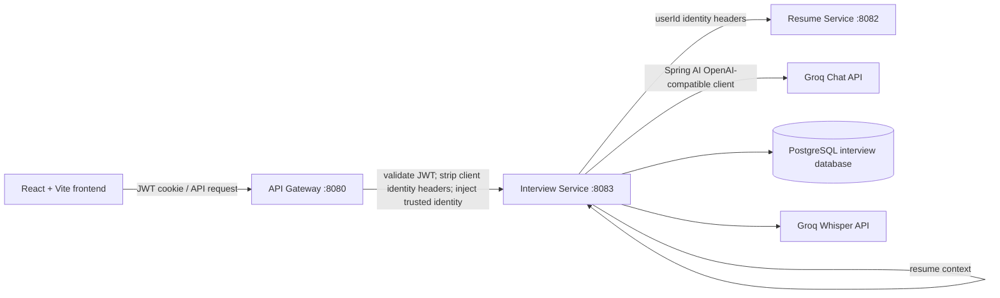

# TalentPrep Interview Service — Project Context

> This file is the working architecture and frontend integration contract for this service. It describes the code in this ZIP after the November 2026 cleanup. The API Gateway remains the authentication boundary; this service does not validate JWTs.

## 1. What this service does

The Interview Service powers TalentPrep's AI interview workflow. It creates interview sessions from a candidate's saved resume context, generates questions for selected interview rounds, evaluates answers with an LLM, stores the interview transcript and scores, and produces a report.

- Service name: `interview-service`
- Default port: `8083`
- API prefix: `/api/interviews`
- Expected Gateway route: `Path=/api/interviews/**` -> `http://localhost:8083` (use the deployed internal Interview Service URL in production)
- Health endpoint: `GET /health`
- Database: PostgreSQL
- Schema management: Flyway (`ddl-auto: validate`)
- AI provider: Groq's OpenAI-compatible API through Spring AI
- Resume dependency: Resume Service (default `http://localhost:8082`)
- Runtime: Java 17+ (the project has been developed and should be built with the Java version configured in `pom.xml`)

## 2. High-level microservice architecture



### Request trust flow

1. The frontend sends requests to the **API Gateway**, not directly to port `8083`.
2. The Gateway validates the JWT. In the current TalentPrep design, the JWT subject is the email and the `userId` claim is the stable UUID.
3. Before forwarding, the Gateway must remove any client-supplied identity headers and inject its own validated values:
   - `X-Authenticated-User-Id: <UUID>`
   - `X-Authenticated-User-Email: <email>` (optional for this service)
   - Legacy aliases `X-User-Id` and `X-User-Email` are accepted for compatibility.
4. `GatewayIdentityFilter` parses the UUID and stores an `AuthenticatedUser` object on the servlet request. It does **not** decode or validate JWTs.
5. `GatewayIdentityHelper` retrieves that request attribute and passes the UUID to application services. Every session read/write still checks that `InterviewSession.userId` matches this UUID.

**Critical deployment requirement:** a header-only downstream identity filter is safe only when untrusted clients cannot reach the Interview Service directly. Keep port `8083` private/internal, route it through the Gateway, and configure the Gateway to strip and overwrite identity headers. Do not expose this service publicly with the assumption that UUID headers prove identity. Network isolation (and ideally service-to-service authentication) is part of the security boundary.

The Interview -> Resume call forwards the authenticated UUID in `X-Authenticated-User-Id` and `X-User-Id` and adds `X-Internal-Service-Name: interview-service` plus `X-Internal-Service-Token`. Resume Service validates the shared service credential and still applies its own resume ownership check against the forwarded user UUID. Configure `INTERVIEW_TO_RESUME_INTERNAL_TOKEN` to the same high-entropy value in both services. Never expose this secret to the browser or commit it.

## 3. Internal package architecture

```text
com.talentprep.interview
├── agent/
│   ├── InterviewAgent                 # Coordinates question/evaluation decisions
│   ├── InterviewOrchestrator          # Resolves strategy by RoundType (EnumMap)
│   ├── InterviewStrategy              # Strategy contract
│   ├── dto/                           # AI request/response and conversation history
│   ├── prompt/                         # Round-specific prompt builders
│   └── strategy/                       # Technical, Coding, Project, SystemDesign, Behavioral
├── client/                             # Resume Service HTTP client + response DTOs
├── coding/                             # Code execution interface and disabled safe placeholder
├── config/                             # Spring AI configuration
├── context/                            # Resume profile -> immutable candidate context mapping
├── controller/                         # HTTP controllers and health endpoint
├── dto/                                # Frontend request/response contracts
├── entity/                             # JPA entities and lifecycle enums
├── evaluation/                         # Answer evaluation persistence and report aggregation
├── exception/                          # Domain/integration exceptions and API error mapping
├── repository/                         # Spring Data JPA repositories
├── identity/                           # Gateway identity request filter and identity helper
├── session/
│   ├── InterviewSessionService          # Setup, session creation and round/session orchestration
│   ├── InterviewSessionQueryService     # Read-only session, transcript and report queries
│   ├── InterviewSessionLifecycleService # Pause/resume/skip/end transitions
│   ├── InterviewQuestionService         # AI question generation, persistence and response mapping
│   └── InterviewAnswerService           # Answer persistence, evaluation hand-off and question status
├── usage/                              # Atomic entitlement/quota reservation
└── voice/                              # Groq Whisper STT and TTS abstraction/placeholder
```

### Important design patterns

- **Layered architecture:** controllers handle HTTP; services implement use cases; repositories persist entities; clients integrate with other services.
- **Strategy pattern:** each interview round has a dedicated strategy and prompt builder. `InterviewOrchestrator` selects by `RoundType` rather than a large `if/else` chain.
- **Immutable candidate snapshot:** `CandidateContextSnapshot` stores the resume-derived context at session creation. If a candidate updates their resume later, an existing interview remains reproducible against the context it started with.
- **Ownership enforcement:** `userId` is stored on the session and checked on each session-scoped operation. UUIDs are identifiers, not authorization by themselves.
- **Quota reservation:** the usage record is pessimistically locked while the service checks and reserves quota, avoiding concurrent requests overspending the same allowance.
- **Optimistic locking:** `InterviewSession.version` uses JPA `@Version`. This helps detect concurrent writes to a session row; it does not automatically serialize every related question/answer row operation.

## 4. Main data model

| Entity | Purpose |
|---|---|
| `InterviewSession` | Owner UUID, status, difficulty, mode, role, duration, current round, timestamps, optimistic version |
| `CandidateContextSnapshot` | Immutable resume-derived candidate profile used by the session |
| `InterviewRound` | Round type/order, target and completed question counts, score and lifecycle state |
| `InterviewQuestion` | Question text/category/difficulty, follow-up marker, coding metadata, question status |
| `InterviewAnswer` | Text/audio/code answer and timing/transcription metadata |
| `AnswerEvaluation` | Overall and dimension scores, feedback, strengths, improvements, AI follow-up decision/reason |
| `InterviewReport` | Overall score, round breakdown, strengths, weaknesses, improvement areas and recommended topics |
| `InterviewUsage` | Plan type, reserved/consumed sessions and renewal allowance |

### Lifecycle overview

```mermaid
stateDiagram-v2
    [*] --> CREATED
    CREATED --> IN_PROGRESS: start
    IN_PROGRESS --> PAUSED: pause
    PAUSED --> IN_PROGRESS: resume
    IN_PROGRESS --> ROUND_TRANSITION: round finished; another round remains
    ROUND_TRANSITION --> IN_PROGRESS: next round question requested
    IN_PROGRESS --> COMPLETED: final round finished / end early
    COMPLETED --> REPORT_GENERATED: report aggregation
```



Questions have `PENDING`, `ANSWERED`, or `SKIPPED` status; rounds have their own pending/in-progress/completed lifecycle. The service uses a session-level current-round index to identify the active round.

## 5. End-to-end interview flow

### A. Setup

`GET /api/interviews/setup` calls `CandidateContextService`. If `resumeId` is provided, the service asks Resume Service for that resume's profile; otherwise it resolves the user's active resume. The service validates that the returned candidate UUID matches the authenticated UUID, maps the profile into `CandidateContext`, and returns the setup fields plus quota availability.

Resume Service endpoints currently called by this service:

- `GET /api/resumes/{resumeId}/profile`
- `GET /api/resumes/details` (used to locate the active resume ID)

Both calls carry the internal service credential and the authenticated user UUID. The shared credential authenticates the calling workload; it does not replace per-resume ownership checks.

### B. Create session

`POST /api/interviews` reserves quota, loads authoritative resume context, writes a `CandidateContextSnapshot`, creates an `InterviewSession`, and creates one `InterviewRound` per selected round. It returns a session in `CREATED` state. The requested `difficulty` is stored on the session; it is not an identity/security claim.

### C. Start session / generate question

`POST /api/interviews/{id}/start` consumes the reserved quota, marks the session and first round active, restores the saved candidate context, and calls `InterviewAgent.askNextQuestion`.

Question generation path:

```text
InterviewSessionService (session/round state)
  -> InterviewQuestionService (generation + persistence)
      -> InterviewAgent
      -> InterviewOrchestrator.getStrategy(roundType)
          -> selected InterviewStrategy
              -> round-specific PromptBuilder
                  -> Spring AI ChatClient -> Groq
      -> AgentQuestionResponse
  -> persist InterviewQuestion
  -> return InterviewQuestionResponse
```

The session's chosen difficulty is passed to the strategy and is authoritative. The parser normalizes the returned question difficulty to the selected level. `MIXED` is implemented as a per-question cycle: EASY, MEDIUM, HARD, then repeat. A follow-up inherits the difficulty of the question it probes.

### D. Submit answer and evaluate

`POST /api/interviews/{id}/answers` validates ownership and state, builds prior-turn context, and delegates answer persistence/evaluation to `InterviewAnswerService`, which invokes `AnswerEvaluationService`. `InterviewSessionService` then updates round/session progression. The evaluation contains:

- Overall score (0–100)
- Technical accuracy, completeness, clarity and problem-solving scores
- Feedback, strengths, improvements and suggested ideal answer
- `triggersFollowUp` and `followUpReason`

AI evaluation failures or malformed AI JSON now fail with HTTP `503 AI_EVALUATION_UNAVAILABLE`; the service does not fabricate a score of 75. Empty/skipped answers are recorded with a zero score and explicit feedback without an AI call.

### E. Contextual follow-up

The evaluation's follow-up decision and reason are persisted. When the next question is requested, `InterviewAgent` checks the immediately preceding turn. It generates a follow-up only when the saved evaluation explicitly set `triggersFollowUp=true`, and it does not chain another follow-up from a follow-up answer. Answer length alone is not a trigger. The selected session difficulty is preserved.

### F. Report

`ReportGenerationService` aggregates saved evaluations by round. Weaknesses are currently derived from the evaluation's `improvements` list because the evaluation schema does not have a separate weaknesses field. If no answers were evaluated, the report uses `overallScore=0` as a documented “not evaluated” sentinel rather than inventing a passing score of 70. Frontend should display the summary and avoid treating this sentinel as a real score.

## 6. Frontend API contract

### Base URL and headers

Set the frontend API base URL to the API Gateway origin (for example, your deployed Gateway URL or `http://localhost:8080`). Use the `/api/interviews` paths below.

If authentication uses an HttpOnly cookie, keep `withCredentials: true` in the frontend HTTP client as configured for the rest of TalentPrep. The frontend must **not** send `X-Authenticated-User-Id`, `X-User-Id`, or email identity headers. The Gateway derives and injects those after validating the JWT.

All `/api/interviews/**` routes require a trusted identity header injected by the Gateway. Only `/health` is public for health checks.

### Endpoint reference

| Method | Path | Purpose | Success response |
|---|---|---|---|
| GET | `/api/interviews/setup` | Prefill setup from active resume | `CandidateSetupDetailsResponse` |
| GET | `/api/interviews/setup?resumeId={uuid}` | Prefill setup from a specific resume | `CandidateSetupDetailsResponse` |
| POST | `/api/interviews` | Create session and rounds | `201 InterviewSessionResponse` |
| GET | `/api/interviews/{id}` | Session details and round states | `InterviewSessionResponse` |
| POST | `/api/interviews/{id}/start` | Start session and create first question | `InterviewQuestionResponse` |
| GET | `/api/interviews/{id}/next-question` | Get pending or generate next question | `InterviewQuestionResponse`, or `204` when finished |
| POST | `/api/interviews/{id}/answers` | Submit text answer and evaluate | `AnswerEvaluationResponseDto` |
| POST | `/api/interviews/{id}/voice-answer` | Upload audio, transcribe and evaluate | `AnswerEvaluationResponseDto` |
| POST | `/api/interviews/{id}/code/run` | Request code execution | `CodeRunResult` (currently reports unavailable) |
| POST | `/api/interviews/{id}/code/submit` | Submit code text for AI review | `AnswerEvaluationResponseDto` |
| POST | `/api/interviews/{id}/pause` | Pause session | `200` empty body |
| POST | `/api/interviews/{id}/resume` | Resume paused session | `200` empty body |
| POST | `/api/interviews/{id}/skip?questionId={uuid}` | Skip current question | `200` empty body |
| POST | `/api/interviews/{id}/end` | End early and generate report | `InterviewReportResponse` |
| GET | `/api/interviews/{id}/transcript` | Retrieve transcript | `InterviewTranscriptResponse` |
| GET | `/api/interviews/{id}/report` | Retrieve generated report | `InterviewReportResponse` |
| GET | `/health` | Health check (no identity required) | `{ "status": "UP", "service": "interview-service", "port": "8083" }` |

### Create session — request example

```json
{
  "resumeId": "7d47e2c5-6a54-4c72-8c19-55d68fd913f1",
  "difficulty": "HARD",
  "mode": "TEXT",
  "rounds": ["TECHNICAL", "CODING", "PROJECT"],
  "targetRole": "Java Backend Developer",
  "targetJobDescription": "Build Java and Spring Boot microservices...",
  "durationMinutes": 45
}
```

Allowed values:

- `difficulty`: `EASY`, `MEDIUM`, `HARD`, `MIXED`
- `mode`: `TEXT`, `VOICE`
- `rounds`: one or more of `TECHNICAL`, `CODING`, `PROJECT`, `SYSTEM_DESIGN`, `BEHAVIORAL`
- `resumeId`: optional; omitted means use active resume
- `durationMinutes`: optional; defaults to 45

Example response shape:

```json
{
  "id": "session-uuid",
  "userId": "authenticated-user-uuid",
  "resumeId": "resume-uuid",
  "status": "CREATED",
  "difficulty": "HARD",
  "mode": "TEXT",
  "targetRole": "Java Backend Developer",
  "durationMinutes": 45,
  "currentRoundIndex": 0,
  "totalRounds": 3,
  "rounds": [
    {
      "id": "round-uuid",
      "roundOrder": 1,
      "roundType": "TECHNICAL",
      "status": "PENDING",
      "targetQuestionCount": 4,
      "completedQuestionCount": 0,
      "roundScore": null
    }
  ]
}
```

### Start / next question response shape

```json
{
  "questionId": "question-uuid",
  "roundId": "round-uuid",
  "sessionId": "session-uuid",
  "roundOrder": 1,
  "roundType": "TECHNICAL",
  "questionOrder": 1,
  "targetQuestionCount": 4,
  "questionText": "Explain how Spring manages bean scopes...",
  "questionCategory": "Spring / Dependency Injection",
  "difficulty": "HARD",
  "isFollowUp": false,
  "questionStatus": "PENDING",
  "codingBoilerplate": null,
  "codingTestCases": []
}
```

### Submit text answer — request example

```json
{
  "questionId": "question-uuid",
  "answerText": "A Spring singleton bean is created once per application context...",
  "timeTakenSeconds": 95
}
```

Response contains `score`, `technicalAccuracy`, `completeness`, `clarity`, `problemSolving`, `feedback`, `strengths`, `improvements`, `suggestedIdealAnswer`, `roundCompleted`, `interviewCompleted`, and `currentRoundIndex`.

### Voice answer — multipart form

Send `multipart/form-data` with:

- `questionId`: question UUID
- `audio`: audio file (max configured file size 25 MB)

Groq Whisper requires `GROQ_API_KEY`. If it is missing or transcription fails, the service returns `503 VOICE_TRANSCRIPTION_UNAVAILABLE`; it does not invent a transcript.

### Code run / code submit — request example

```json
{
  "questionId": "question-uuid",
  "language": "java",
  "code": "public class Main { ... }"
}
```

### Code Execution via OnlineCompiler.io API

The Interview Service integrates with the **OnlineCompiler.io API** (`https://api.onlinecompiler.io`) for sandboxed, isolated code execution and deterministic autograding.
- **Run Code (`POST /api/interviews/{id}/code/run`):** Executes against visible sample test cases in an isolated sandbox. Returns real compilation output, standard output, standard error, execution time (ms), peak memory (bytes), test cases passed, and individual test verdicts.
- **Submit Code (`POST /api/interviews/{id}/code/submit`):** Executes against both visible and authoritative hidden test cases. Evaluates deterministic pass percentage, protects hidden test cases from leaking to the frontend, persists submission and execution metrics to PostgreSQL, and triggers token-efficient Spring AI qualitative review (Big-O time and space complexity, readability, and improvement suggestions).
- **Supported Languages:** Java (`openjdk-25`), Python (`python-3.14`), C++ (`g++-15`), JavaScript (`nodejs-24`), TypeScript (`typescript-deno`).
- **PostgreSQL Question Bank:** Curated DSA questions across Easy, Medium, and Hard pre-seeded with multi-language starter templates, sample cases, and hidden test suites.

## 7. Error response contract

Most handled errors use this shape:

```json
{
  "timestamp": "2026-11-03T18:00:00",
  "status": 503,
  "error": "AI_EVALUATION_UNAVAILABLE",
  "message": "AI evaluation is temporarily unavailable. Your answer was not assigned a score."
}
```

Important error codes/statuses:

| HTTP | Error | Meaning |
|---|---|---|
| 400 | `BAD_REQUEST` / `VALIDATION_FAILED` / `INVALID_GATEWAY_USER_ID` | Invalid input or malformed gateway UUID header |
| 401 | `MISSING_GATEWAY_IDENTITY` | Gateway identity missing |
| 403 | `FORBIDDEN` | User does not own the requested session |
| 404 | `NOT_FOUND` | Session not found |
| 404 | `REPORT_NOT_FOUND` | Report has not been generated yet |
| 409 | `INVALID_STATE` | Operation is invalid for current lifecycle state |
| 429 | `QUOTA_EXCEEDED` | Plan quota exhausted |
| 502 | `RESUME_INTEGRATION_ERROR` | Resume Service failure or ownership mismatch |
| 503 | `AI_EVALUATION_UNAVAILABLE` | AI answer evaluation unavailable/invalid |
| 503 | `VOICE_TRANSCRIPTION_UNAVAILABLE` | STT not configured or failed |

## 8. Configuration and local run

### Environment variables

| Variable | Default / purpose |
|---|---|
| `DB_URL` | `jdbc:postgresql://localhost:5432/talentprep_interviews` |
| `DB_USERNAME` | `postgres` |
| `DB_PASSWORD` | `postgres` |
| `RESUME_SERVICE_URL` | `http://localhost:8082` |
| `GROQ_API_KEY` | Required for AI chat and Whisper STT; no deterministic mock AI model is registered |
| `GROQ_BASE_URL` | `https://api.groq.com/openai/v1` |
| `INTERVIEW_AI_MODEL` | `qwen/qwen3.8-27b` |
| `INTERVIEW_AI_TEMPERATURE` | `0.3` |
| `INTERVIEW_AI_MAX_TOKENS` | `4096` |
| `SPRING_PROFILES_ACTIVE` | `local` by default |
| `VOICE_STORAGE_PATH` | `./uploads/interview-audio` (voice storage configuration) |

### Start locally

1. Start PostgreSQL and create database `talentprep_interviews`.
2. Set `DB_URL`, `DB_USERNAME`, `DB_PASSWORD`, `GROQ_API_KEY`, and `RESUME_SERVICE_URL` in your environment or IDE run configuration.
3. Start Auth, Resume and API Gateway services as needed. The frontend should call the Gateway on port `8080`.
4. From this directory run:

```bash
./mvnw clean test
./mvnw spring-boot:run
```

On Windows PowerShell:

```powershell
.\mvnw.cmd clean test
.\mvnw.cmd spring-boot:run
```

Flyway applies `V1__init_interview_schema.sql` and `V2__persist_ai_follow_up_decision.sql`; Hibernate validates the schema. Build/test verification was not possible in the generation environment because the Maven Wrapper distribution download from Maven Central failed; run the commands above in your development environment before deployment. Do not switch `ddl-auto` back to `update` in a deployed environment.

## 9. Changes made in this cleanup

1. Removed Spring Security starter and `SecurityConfig`; no JWT parsing or validation remains in this service.
2. Replaced SecurityContext-based identity with a small servlet request attribute populated from Gateway identity headers. Protected routes reject missing identity; malformed UUIDs return 400.
3. Kept ownership checks in the service layer. The filter is not a substitute for the Gateway's header-stripping/injection and private network boundary.
4. Extracted read-only session, transcript and report queries into `InterviewSessionQueryService`, and pause/resume/skip/end transitions into `InterviewSessionLifecycleService`.
5. Replaced the answer-length/mock-evaluation follow-up heuristic with persisted AI `triggersFollowUp` / `followUpReason` fields (Flyway V2).
6. Made follow-up questions AI-generated and grounded in the evaluation reason. Prevents consecutive follow-up chains.
7. Preserved requested difficulty through prompt generation and follow-ups; `MIXED` rotates EASY → MEDIUM → HARD.
8. Removed fabricated 75/100 evaluation fallback. AI evaluation failures now return 503 and do not save a made-up score.
9. Fixed report weaknesses aggregation by deriving weaknesses from persisted evaluation improvements; removed invented default strengths/improvements and the fabricated 70 score for no-answer sessions.
10. Removed the deterministic mock ChatModel and fake evaluation fallback. All five score fields must be returned by the AI; missing values fail closed with 503 instead of copying the overall score into missing dimensions.
11. Removed heuristic fake code execution and fake Whisper transcript/duration. Code execution is explicitly disabled pending a real isolated runner; STT requires Groq credentials.
12. Fixed skip handling so skipped questions remain `SKIPPED`, excluded the current answer from its own evaluation history, made report generation idempotent, and return a specific 404 when a report is not yet available.
13. Extracted `InterviewQuestionService` and `InterviewAnswerService` so question generation and answer persistence/evaluation no longer live inside the session orchestration class. Kept round progression in `InterviewSessionService`.
14. Kept the five round strategies, five prompt builders, candidate snapshots, existing JPA entity model, and Flyway-managed schema; added only the follow-up decision columns.

## 10. Known limitations / next engineering steps

- `InterviewSessionService` still coordinates setup/session creation, session/round state progression, voice/code submission and report-trigger decisions. Question generation and answer persistence/evaluation are now separate services; a future change could further isolate voice/code workflows.
- The real code execution sandbox is not implemented. Code run is disabled until an isolated runner is integrated.
- `SimpleTextToSpeechService` is a placeholder that returns text bytes, not synthesized audio. Do not use it as a production TTS implementation.
- AI-generated initial and follow-up questions still have static fallback questions if question generation fails. AI **evaluation** does not have a fabricated-score fallback; all required score dimensions must be present.
- The report's `weaknesses` currently reuse evaluation `improvements`; if you need distinct weakness labels, add a separate `weaknesses` field to the evaluation JSON/entity and a Flyway migration.
- `@Version` on the session entity detects conflicting session writes, but a dedicated locking strategy for related question/answer transitions should be considered for high concurrency.
- Keep an eye on transaction duration: AI network calls currently occur within some write transactions. A later design can split the workflow into short DB state transitions plus idempotent AI work with explicit pending states.
- Verify the Gateway route, cookie forwarding, identity header stripping, and private networking in the deployed environment. The service cannot defend itself against a caller that can directly reach port 8083 and forge the gateway headers.

---

**Frontend rule of thumb:** call only the Gateway, send business inputs such as difficulty/mode/rounds in the JSON body, and let the Gateway derive identity from the JWT. Difficulty is interview configuration—not an authentication claim—and is persisted in `InterviewSession.difficulty`.

---

# Hybrid REST + WebSocket Communication (November 12, 2026)

The service now supports a hybrid communication model. REST remains the interface for setup, session creation and reads, transcript/report retrieval, multipart voice uploads, and code operations. STOMP over WebSocket is the primary interface for live interview lifecycle commands and server-pushed events.

## WebSocket contract

- WebSocket handshake endpoint: `/ws/interviews` (connect through API Gateway only).
- STOMP application prefix: `/app`.
- Command destination: `/app/interviews/{sessionId}/commands`.
- User event subscription: `/user/queue/interviews/events`.
- The Gateway validates the `AccessToken` HttpOnly cookie on the HTTP upgrade request and injects trusted identity headers.
- The Interview Service's existing `GatewayIdentityFilter` validates the UUID and stores an `AuthenticatedUser` request attribute. `InterviewHandshakeInterceptor` requires that request attribute; `InterviewHandshakeHandler` establishes an `InterviewPrincipal` for STOMP.
- STOMP CONNECT requires the `X-XSRF-TOKEN` native header to match the `XSRF-TOKEN` cookie received during the handshake. Configure exact allowed frontend origins.
- The STOMP inbound interceptor restricts SEND to `/app/interviews/**` and SUBSCRIBE to `/user/queue/interviews/events`. The Gateway forwards the validated access-token expiry; the Interview Service rejects expired STOMP frames and closes the socket at token expiry.
- Commands derive user identity from the authenticated STOMP Principal, never from the command payload. Existing application services continue enforcing interview ownership.

## Commands and events

Supported commands: `START_INTERVIEW`, `NEXT_QUESTION`, `SUBMIT_ANSWER`, `PAUSE_INTERVIEW`, `RESUME_INTERVIEW`, `SKIP_QUESTION`, and `END_INTERVIEW`.

Events include `COMMAND_ACKNOWLEDGED`, `INTERVIEW_STARTED`, `QUESTION_GENERATED`, `NO_MORE_QUESTIONS`, `EVALUATION_STARTED`, `EVALUATION_COMPLETED`, `ROUND_COMPLETED`, `INTERVIEW_PAUSED`, `INTERVIEW_RESUMED`, `QUESTION_SKIPPED`, `INTERVIEW_COMPLETED`, and `COMMAND_FAILED`.

`commandId` is a correlation identifier, not a durable idempotency key. A command acknowledgement means accepted for processing, not completed. After a disconnect, the frontend must reconnect and use REST to retrieve authoritative session state before deciding whether to issue another command. Existing service guards prevent starting a session twice and prevent submitting an already answered question, but persistent exactly-once command deduplication is not implemented.

## Deployment requirements

- Gateway route `/ws/interviews` must target `INTERVIEW_WEBSOCKET_URL` using `ws://` internally and `wss://` externally.
- Keep Interview Service port 8083 private. Header-based identity is safe only behind the trusted Gateway boundary.
- Set `INTERVIEW_WEBSOCKET_ALLOWED_ORIGINS` to exact frontend origins, comma-separated.
- Set Gateway and Auth CSRF cookie policy consistently. Use `Secure=true` in production. For cross-site frontend/API deployments use `SameSite=None; Secure`; for same-site local development use an appropriate local profile (for example `AUTH_COOKIE_SECURE=false`, `AUTH_COOKIE_SAME_SITE=Lax`, and corresponding Gateway CSRF settings).
- The current simple STOMP broker is process-local. Multi-instance Interview Service deployments need a shared broker relay or equivalent broker infrastructure.
- The bounded command executor prevents slow AI operations from blocking the inbound STOMP channel, but production capacity should be tuned from load testing.

See `WEBSOCKET_FRONTEND_INTEGRATION.md` for the complete frontend contract and examples.


## 15. Async follow-up and next-question preparation (November 2026 update)

The answer flow now dispatches answer evaluation, follow-up decision, and next-main-question preparation independently. The main question is persisted with `question_status=READY` and `prepared_for_question_id=<answered root question>`; it is delivered only after a `MOVE_ON` decision. Follow-ups are persisted as `READY`, then delivered after the persistence transaction commits. `QuestionFlowCoordinator` gates delivery and prevents duplicate transitions by locking READY questions.

The follow-up decision contract is `ASK_FOLLOW_UP` or `MOVE_ON`. Legacy `CLARIFY` model responses are normalized to `ASK_FOLLOW_UP`. A correct concise answer should move on; follow-ups are reserved for essential missing concepts, materially ambiguous answers, or technically important claims that need probing. The prompt includes the evaluator's suggested ideal answer when it is already available and otherwise asks the model to infer essential concepts from the original question and role.

New WebSocket events: `ANSWER_SUBMITTED`, `ANSWER_EVALUATED`, and `FOLLOW_UP_READY`. `ANSWER_RECEIVED` remains emitted for backward compatibility. `NEXT_QUESTION_READY` and `INTERVIEW_ERROR` remain part of the event contract. See `INTERVIEW_FOLLOW_UP_FLOW.md`.

Apply `V5__async_question_preparation_and_lifecycle.sql` manually before deploying this version. The migration aligns the named PostgreSQL status check with `QuestionStatus` (`READY`, `PENDING`, `ANSWERED`, `SKIPPED`) and adds async preparation linkage columns.
